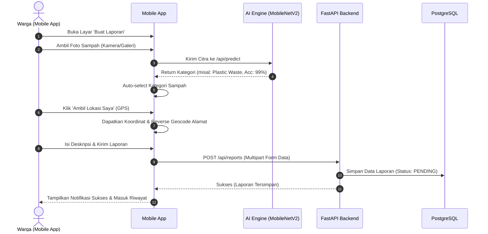

# 📱 Smart Waste Citizen Mobile Application

> **Aplikasi Mobile Pelaporan Sampah Warga Berbasis React Native, Expo SDK, dan Expo Router.**  
> Memfasilitasi masyarakat untuk memotret timbunan sampah, mendapatkan deteksi jenis sampah otomatis oleh AI (*MobileNetV2*), menandai titik koordinat GPS secara realtime, dan memantau status penanganan oleh dinas kebersihan langsung dari ponsel pintar.

---

## 📑 Daftar Isi
1. [Fitur Unggulan Aplikasi Mobile](#-fitur-unggulan-aplikasi-mobile)
2. [Struktur Direktori `mobile/src/`](#-struktur-direktori-mobilesrc)
3. [Panduan Instalasi & Eksekusi](#-panduan-instalasi--eksekusi)
4. [Pengaturan Koneksi ke Backend (Khusus HP Fisik)](#-pengaturan-koneksi-ke-backend-khusus-hp-fisik)
5. [Alur Fitur Utama Aplikasi](#-alur-fitur-utama-aplikasi)
6. [Panduan Pembuatan Berkas APK (EAS Build)](#-panduan-pembuatan-berkas-apk-eas-build)

---

## 🚀 Fitur Unggulan Aplikasi Mobile

* **📸 Kamera & Galeri Foto:**
  * Pengambilan foto sampah langsung menggunakan kamera perangkat atau memilih foto dari galeri via pustaka **`expo-image-picker`**.
* **📍 Deteksi Lokasi GPS Realtime:**
  * Pengambilan titik koordinat garis lintang (*latitude*) dan bujur (*longitude*) perangkat secara presisi via **`expo-location`**.
  * Konversi koordinat otomatis menjadi alamat nama jalan/daerah (*Reverse Geocoding*).
* **🤖 Integrasi Deteksi AI Otomatis:**
  * Begitu warga memilih foto sampah, aplikasi secara otomatis mengirimkan gambar ke endpoint AI backend.
  * Hasil klasifikasi (*Organic, Paper, Plastic*) beserta skor persentase keyakinan langsung mengisi pilihan formulir secara otomatis (*auto-prefill*).
* **📊 Dashboard Warga:**
  * Menampilkan salam pembuka personal, banner pintasan cepat *"Buat Laporan"* dan *"Scan Sampah"*, serta ringkasan kartu statistik laporan pribadi (*Pending, Diproses, Selesai*).
* **📑 Riwayat & Pelacakan Status Laporan:**
  * Tab riwayat yang dilengkapi chip filter status (*Semua, Pending, Diproses, Selesai, Ditolak*) dan fungsi tarik untuk memperbarui (*Pull-to-refresh*).
  * Modal detail laporan ([`ReportDetailModal.tsx`](src/components/ReportDetailModal.tsx)) menampilkan foto beresolusi penuh, koordinat lokasi, hasil verifikasi AI, dan catatan tindak lanjut dari petugas kebersihan.
* **🔍 AI Waste Scanner Mandiri:**
  * Tab pemindai terdedikasi di mana pengguna dapat memindai objek sampah apa pun untuk mengetahui jenis dan cara penanganan daur ulangnya secara interaktif.

---

## 📂 Struktur Direktori `mobile/src/`

Aplikasi menggunakan arsitektur **Expo Router** (*file-based routing*):

```
mobile/src/
├── global.css                  # Pengaturan styling global aplikasi
│
├── app/                        # Direktori Rute Layar Aplikasi (Expo Router)
│   ├── _layout.tsx             # Root Layout pembungkus AuthProvider & SafeArea
│   ├── index.tsx               # Rute pengarah awal (redirect ke tabs atau login)
│   ├── login.tsx               # Layar Login, Registrasi Warga, & Konfigurasi IP
│   │
│   └── (tabs)/                 # Rute Navigasi Tab Bar Bawah (Bottom Navigation)
│       ├── _layout.tsx         # Konfigurasi ikon & label Bottom Tab Bar
│       ├── index.tsx           # Tab 1: Beranda / Dashboard Warga
│       ├── report.tsx          # Tab 2: Formulir Buat Laporan (Kamera + GPS + AI)
│       ├── history.tsx         # Tab 3: Riwayat & Status Penanganan Laporan
│       ├── scan.tsx            # Tab 4: Fitur Pemindai Citra AI Mandiri
│       └── profile.tsx         # Tab 5: Profil Akun Warga & Tombol Keluar (Logout)
│
├── components/                 # Komponen UI Khusus Mobile
│   ├── AuthModal.tsx           # Modal popup login/register instan
│   ├── ReportDetailModal.tsx   # Modal rincian lengkap laporan & catatan petugas
│   └── StatusPill.tsx          # Komponen badge pill status & kategori berwarna
│
├── context/                    # State Management Sesi & Jaringan
│   └── AuthContext.tsx         # Manajemen JWT token, user state di AsyncStorage, & IP server
│
└── services/                   # Layanan Komunikasi API
    └── api.ts                  # Axios client, handler multipart foto, & dynamic IP resolver
```

---

## 🛠️ Panduan Instalasi & Eksekusi

### 1. Masuk ke Direktori Mobile
```bash
cd mobile
```

### 2. Pasang Dependensi
Pastikan Node.js 18+ sudah terpasang:
```bash
npm install
```

### 3. Jalankan Expo Development Server
```bash
npx expo start
```
Terminal akan menampilkan **QR Code** interaktif beserta opsi pintasan tombol:
* Tekan `a` untuk membuka di Emulator Android.
* Tekan `w` untuk membuka di Web Browser.
* Tekan `c` untuk membersihkan cache terminal.

---

## 📶 Pengaturan Koneksi ke Backend (Khusus HP Fisik)

Jika Anda menjalankan aplikasi di **HP fisik melalui Expo Go**, HP dan Laptop/PC Anda harus terhubung ke **jaringan Wi-Fi yang sama**.

1. Cek alamat IP lokal komputer Anda (buka PowerShell/CMD dan ketik `ipconfig`, cari bagian *IPv4 Address*, misalnya: `192.168.1.14`).
2. Buka aplikasi di HP melalui Expo Go.
3. Di layar Login aplikasi mobile, klik tombol **"⚙️ Atur IP Server Backend"**.
4. Masukkan alamat IP komputer Anda (contoh: `192.168.1.14`) lalu klik **Simpan IP**.
5. Aplikasi mobile sekarang dapat mengirimkan data dan foto langsung ke server backend FastAPI di laptop Anda.

---

## 🔄 Alur Fitur Utama Aplikasi



---

## 📱 Panduan Pembuatan Berkas APK (EAS Build)

Untuk menghasilkan berkas mandiri installer Android (`.apk`) tanpa memerlukan Android Studio lokal, gunakan layanan **Expo Application Services (EAS Build)**:

1. Pasang EAS CLI secara global:
   ```bash
   npm install -g eas-cli
   ```
2. Masuk ke akun Expo Anda:
   ```bash
   eas login
   ```
3. Lakukan build APK dengan profil *preview*:
   ```bash
   eas build -p android --profile preview
   ```
4. Setelah proses build di cloud selesai (sekitar 5-10 menit), tautan unduhan berkas `.apk` langsung tersedia untuk diinstal di perangkat Android mana pun.
